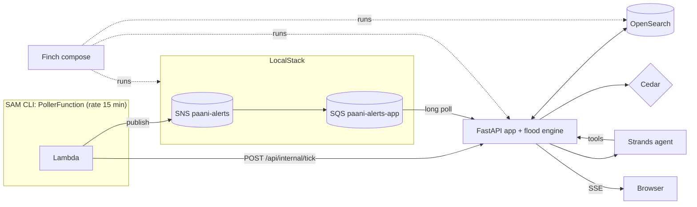

# Paani Kahan

**Which streets will flood in the next 6 hours, and how deep.** A street-level monsoon flood forecast that checks your commute before you leave, and hands you to Google Maps on a route that stays dry.

Built for Environmental Hacks 2026 (Track 02: Heat and Water) with AWS open-source tools: **OpenSearch, Strands Agents SDK, Cedar, AWS SAM CLI, LocalStack and Finch.**


---

## Run it

You need **Finch** (or Docker) and about 4 GB of free RAM.

```bash
make up                 # or: finch compose up --build -d   (docker compose works too)
open http://localhost:8080
```

That's it. The first start takes about a minute: OpenSearch boots, the flood model runs, and a demo commute is chosen.

**Recommended, before recording the demo:**

```bash
make data               # real Velachery streets (OpenStreetMap) + terrain (AWS Terrain Tiles)
make model              # ollama pull llama3.2:3b, the local model for the Strands agent
make tick               # the nowcast update: SAM Lambda -> SNS -> SQS on LocalStack -> your browser
```

Without `make data` the app runs on a bundled **sample area** (invented streets, labelled "sample streets" in the UI). Without Ollama the agent's advice falls back to a template, labelled "Template" in the UI. Everything else works the same.

<details>
<summary>No make? Plain commands</summary>

```bash
finch compose up --build -d                       # or docker compose
python3 scripts/fetch_area.py && finch compose restart app
ollama pull llama3.2:3b
cd serverless && sam local invoke PollerFunction  # uses samconfig.toml: docker network paani-net
# without SAM:  APP_URL=http://localhost:8080 AWS_ENDPOINT=http://localhost:4566 python3 serverless/poller/app.py
curl -X POST localhost:8080/api/internal/reset    # back to 4:10 PM
```
`scripts/fetch_area.py` needs `pip install numpy scipy pillow` on your machine, or run it in the container:
`finch compose run --rm app python scripts/fetch_area.py`.
</details>

### Using it

It works like a maps app, on a phone or a laptop.

| | |
|---|---|
| **Search** (top) | streets, localities, hospitals and schools in the forecast area (OpenSearch), plus places anywhere in India |
| Tap a street | its depth now, a 6-hour depth curve, and past flood reports |
| **Directions** | From / To, travel mode, leave time; routes coloured by depth along their length; **Start in Google Maps** |
| Bottom sheet (phone) | drag between peek, half and full; on a laptop it's the left panel |
| Timeline | scrub the next 6 hours, or press play (Space) |
| Locate button | your position; routes start from "Your location" |
| Layer chips | flood depth, rain, hospitals and schools (emergency control only, by Cedar policy) |
| Account menu (avatar) | switch Priya / Ravi / Control room, theme (auto, light, dark), alerts, install, How it works |
| Keyboard | `/` search · Space play · D how it works · Esc back · + / − zoom |

### Long trips

Search a destination outside the forecast area (another part of the city, or a town two hours away) and the app offers to **build a corridor forecast**: main roads between you and the destination, terrain on a coarser grid sized to the trip (up to about 160 km), and depth checked at the time you'd reach each stretch. Bridges and flyovers are treated as above the water. Local lanes at either end aren't covered, and the app says so.

### Installable, offline, background alerts

It's a Progressive Web App. In Chrome or Edge, use **Install app** from the account menu (or the install icon in the address bar).
- The app and the last forecast are cached, so it opens instantly and works offline, showing "Offline · saved 4:25 PM".
- **Flood alerts on this device** (account menu) turns on system notifications: alerts arrive even when the tab is in the background.
- Installed on Chromium browsers, it also refreshes the forecast in the background about every 15 minutes and notifies you if your commute floods. (Browsers decide the exact timing; iOS doesn't support this yet.)

## Open it on your phone

Browsers only allow **location, offline use, installing and notifications on HTTPS pages**, so there are two options.

**1. Phone link (recommended, everything works).** A free Cloudflare quick tunnel gives the app an `https://….trycloudflare.com` address. No account needed, and it works even when the phone is off your Wi-Fi.

```
finch compose --profile phone up -d
```

Then on the laptop open http://localhost:8080 → account menu (the **P** circle) → **Open on your phone**, and scan the QR code. On the phone: Chrome menu → **Add to Home screen** to install it. The address changes each time the tunnel restarts. Anyone with the link can open the app, so stop it when you're done: `finch compose stop tunnel`.

**2. Same Wi-Fi only (no location, offline or install).** Finch runs containers inside WSL, which only exposes ports to the laptop itself, so Windows needs to forward a port to the Wi-Fi. In PowerShell **as Administrator**, from the project folder:

```
powershell -ExecutionPolicy Bypass -File scripts\phone-lan.ps1
```

It prints an address like `http://192.168.1.20:8081` to open on the phone. To get a QR code for it in the app, put `PHONE_LAN_URL=http://192.168.1.20:8081` in `.env` and run `finch compose up -d app`. If the phone can't connect, set the Wi-Fi network to **Private** in Windows settings (Network & internet → Wi-Fi → your network). Undo with `scripts\phone-lan.ps1 -Remove`.

## Live data

By default everything is live:

| Data | Source | Refresh |
|---|---|---|
| Rain | Open-Meteo forecast at a 3 × 3 grid of points over the area (5 × 5 for long-trip corridors): 15-minute values for the last 2 hours and the next 6.5 | every 15 minutes, automatically |
| Clock | real time, IST | continuous |
| Streets, water bodies, localities, hospitals, schools | OpenStreetMap | when you fetch an area |
| Elevation | Terrain Tiles, AWS Registry of Open Data | when you fetch an area |
| Places in India (search) | OpenStreetMap Nominatim | per search |
| Flood reports | **residents using the app** ("Report water here") | instantly; each report pulls the forecast towards what was seen within 120 m for the next 90 minutes |
| Commute | **yours** (Home, Work, leave time), saved on the server; only you can read it (Cedar) | every forecast update |

There is no public live feed of flood complaints, so reports start empty and grow as people use it. If Open-Meteo can't be reached, the app says "Live rain unavailable · showing demo storm" rather than pretending.

**Demo storm:** How it works → System → *Demo storm* replays a scripted storm at 4:10 PM with the demo commute and seed reports, so a video is reproducible on a dry day. Switch back with *Live*.

## What it does

1. **Forecasts depth per street, every 10 minutes, 6 hours ahead.** Terrain + rainfall nowcast + drain capacity → water depth on each of thousands of street segments.
2. **Checks your saved commute** at the time you'd actually reach each street, against a safe limit for how you travel: 30 cm on a two-wheeler, 45 cm by car, 25 cm on foot.
3. **Finds a dry route** and opens it in **Google Maps** with waypoints that pin it there. You keep using the app you already use.
4. **Stays silent until it matters.** When a new nowcast puts your route under water, you get one notification.
5. **Gives ward officers and emergency control their own view**: which localities to send pumps to first, and which hospitals and schools are about to be cut off.

## Tuned to Chennai

| What | Data | Effect on the forecast |
|---|---|---|
| **Drain capacity** | 35 years of hourly rain (ERA5 via Open-Meteo archive), Gumbel fit of annual maxima | Drains carry the runoff of a ~2-year storm (Indian CPHEEO practice) instead of a guessed 18 mm/h. The app also says how rare the forecast's heaviest hour is ("1-in-5-year downpour") |
| **Wet ground** | Last 3 and 7 days of rain, soil moisture (Open-Meteo) | Runoff rises from 78% (dry) to 95% (saturated); drains lose up to 25% after a very wet few days (silt, already full) |
| **High tide** | Sea level forecast off the coast (Open-Meteo marine) | Drains in the lowest 20% of the area slow by up to 40% around high tide (outfalls into the Adyar, Cooum and the sea back up) |
| **Subways** | Underpasses from OpenStreetMap (`tunnel=yes`, negative `layer`) | Cut 1.8 m into the terrain so they fill first, with pump capacity; marked "likely closed" above 30 cm and avoided by the dry route, as the city closes them |
| **Bridges and flyovers** | OpenStreetMap | Stay dry |
| **Past floods** | Documented subway and road closures (Dec 2021 cloudburst, Cyclone Michaung Dec 2023), with source links | Shown as "documented" history on matching streets; localities with history get weaker drains |
| **Storm replays** | Recorded hourly rain for Michaung 2023, Dec 2015, Nov 2021, Dec 2021 | How it works → System → replay a real storm and see what the model does with it |

## Blockades

| Source | What | Needs |
|---|---|---|
| OpenStreetMap | roads under construction (Metro works), bollards, concrete blocks, gates | nothing; re-run `make data` to pick them up |
| TomTom Traffic Incidents | live road closures, **flooding**, roadworks, accidents | a free key in `TOMTOM_API_KEY` (developer.tomtom.com) |
| Residents | "Road closed" in the Report sheet | nothing; lasts 3 hours |
| The forecast itself | subways above 30 cm | nothing |

Routes avoid all of them and say so ("Avoids Station Rd · closed").

**Accuracy, honestly:** this is calibrated to Chennai's real rainfall climate and checked against real past storms, not validated street by street. Doing that needs measured flood depths and the city's storm-drain network, which aren't public. ERA5 is a 25 km reanalysis, so it smooths short cloudbursts; tide data is coarse at the coast.

## How the flood model works

`app/engine/hydro.py`, about 250 lines.

1. **Terrain.** Priority-flood the elevation grid (20 m cells). This finds every depression where water ponds (underpasses, low colonies, old lake beds) and gives every cell a downhill direction.
2. **Runoff.** Every 10 minutes, rain above the local storm-drain capacity becomes runoff (urban runoff coefficient 0.85).
3. **Routing.** Runoff is passed downhill. A depression stores water until it fills to its spill level, then overflows downstream.
4. **Depth.** Ponded depth comes from each depression's stored volume and shape; moving-water depth comes from discharge via Manning's equation. A street's depth is the deepest point along it.
5. **Calibration.** Localities with more past flood reports get weaker effective drainage.

It's a fast screening model (about a second per 6-hour forecast), not a full 2D hydrodynamic solver. See [Limitations](#limitations).

## Where each AWS tool fits



| Tool | What it does here | Where |
|---|---|---|
| **OpenSearch** | Geo-indexed street segments (`geo_shape`), the time-indexed forecast (one doc per wet street per 10 min), past flood reports (full-text + `geo_point`), hospitals and schools. Answers: flooded streets at time *t* in a locality; per-locality aggregation for pump priority; flood history near a street; which hospitals have a flooded street within 200 m (`msearch` + `geo_distance`). Every query and its DSL is shown in Details → System. | `app/store.py` |
| **Strands Agents SDK** | The advisory agent. Three tools (`check_route`, `flood_history`, `best_departure`); it decides which to call and writes the notification. Local model via Ollama by default; Claude via `MODEL_PROVIDER=anthropic`. Tool calls are shown in Details → Why. | `app/agent.py` |
| **Cedar** | Every API request is authorized by Cedar policies: route checks are public; a saved commute is visible only to its owner; ward officers see operations only for their own locality; vulnerable-site data is for emergency control only. Change `paani.cedar`, restart, no code change. | `app/policies/paani.cedar`, `app/policy.py` |
| **AWS SAM CLI** | `template.yaml` defines the nowcast poller Lambda on a 15-minute EventBridge schedule plus its SNS topic. `sam local invoke` runs it locally against LocalStack. | `serverless/` |
| **LocalStack** | SNS topic → SQS queue, so alerts travel the same event path they would on AWS. The app long-polls SQS and streams alerts to the browser. | `compose.yaml`, `app/alerts.py` |
| **Finch** | `finch compose up` runs OpenSearch, LocalStack and the app. The `Makefile` uses Finch when installed. | `compose.yaml`, `Makefile` |

Also used: **Terrain Tiles on the AWS Registry of Open Data** for elevation (`scripts/fetch_area.py`).

## Project layout

```
app/
  server.py          API, boot sequence, SSE
  engine/
    area.py          loads streets, terrain, localities
    hydro.py         the flood model
    rain.py          demo storm + Open-Meteo nowcast
    routing.py       flood-aware routing + Google Maps handoff
    story.py         picks the demo commute for an area
    history.py       seed flood reports
    sample.py        synthetic sample area
  store.py           OpenSearch (and in-memory fallback)
  agent.py           Strands agent
  policy.py          Cedar
  policies/paani.cedar
  alerts.py          SQS listener + browser event bus
  web/               the interface (no build step)
serverless/          SAM template + poller Lambda
localstack/          SNS -> SQS bootstrap
scripts/fetch_area.py
DEMO.md              shot-by-shot demo plan
WRITEUP.md           submission writeup
```

## Configuration

Copy `.env.example` to `.env`.

| Variable | Default | |
|---|---|---|
| `MODEL_PROVIDER` | `ollama` | or `anthropic` |
| `OLLAMA_MODEL` | `llama3.2:3b` | any Ollama model with tool calling |
| `ANTHROPIC_API_KEY` | | when `MODEL_PROVIDER=anthropic` |
| `AREA` | `velachery` if fetched, else `sample` | folder under `data/` |
| `RAIN_SOURCE` | `live` | `live` (Open-Meteo) or `demo` (scripted storm); also switchable in How it works → System |
| `LIVE_REFRESH_MIN` | `15` | how often live mode re-fetches rain and re-runs the model |
| `DEMO_NOW` | `16:10` | the clock in demo-storm mode (live mode uses the real time, IST) |

Another area: `python3 scripts/fetch_area.py --id adyar --bbox 12.995,80.240,13.020,80.270 --name Adyar` then `AREA=adyar`.

## Troubleshooting

- **Phone: "Open on your phone" shows no link** after starting the tunnel: wait 10 seconds and open it again; check `finch compose logs tunnel` for a `trycloudflare.com` line.
- **Phone: the location button says it needs HTTPS**: you opened the Wi-Fi address; use the phone link.

- **The status dots in the top right** show OpenSearch, agent, Cedar and alerts. Amber means that piece is running in fallback mode. Details → System says why.
- **OpenSearch exits on Linux:** `sudo sysctl -w vm.max_map_count=262144`.
- **Agent shows "Template":** start Ollama (`ollama serve`) and `make model`. On Linux with Docker, Ollama must listen on all interfaces: `OLLAMA_HOST=0.0.0.0 ollama serve`.
- **`sam local invoke` can't reach the app:** it runs on the `paani-net` network (set in `serverless/samconfig.toml`), so the app must be running via compose. SAM CLI supports Finch as its container runtime.
- **LocalStack asks for an auth token:** the compose file pins `localstack/localstack:3.8.1`, which runs without one. If you change the tag, set `LOCALSTACK_AUTH_TOKEN`. Without LocalStack, use Details → System → *Run nowcast update* (delivers in-process; the UI says so).
- **First boot is slow on real data:** choosing the demo commute runs a few hundred route checks once; the result is saved to `data/<area>/area.json`.

## Limitations

- **Elevation** is SRTM-derived (30 m, measures rooftops and trees in dense areas). Production would use CartoDEM or municipal LiDAR, plus storm-drain network maps.
- **Past flood reports are synthetic seed data** (marked `synthetic-seed`, shown as "seed data"). Production would ingest GCC / Namma Chennai complaint records.
- **The demo storm is scripted** so the video is reproducible. `RAIN_SOURCE=open-meteo` uses a live forecast. IMD radar nowcasts would be the production source.
- **Routing** treats streets as two-way. Google Maps does the actual navigation.
- **Bridges and flyovers** are read from OpenStreetMap tags. If you fetched Velachery before this version, run `make data` again to pick them up.
- Depth estimates are indicative, not survey-grade. Say "forecast", never "guaranteed".

## Data and licences

Streets, water bodies, localities and facilities: © OpenStreetMap contributors (ODbL). Elevation: Terrain Tiles, AWS Registry of Open Data (SRTM, public domain). Fonts: Schibsted Grotesk and Martian Mono (SIL OFL) via Google Fonts.
