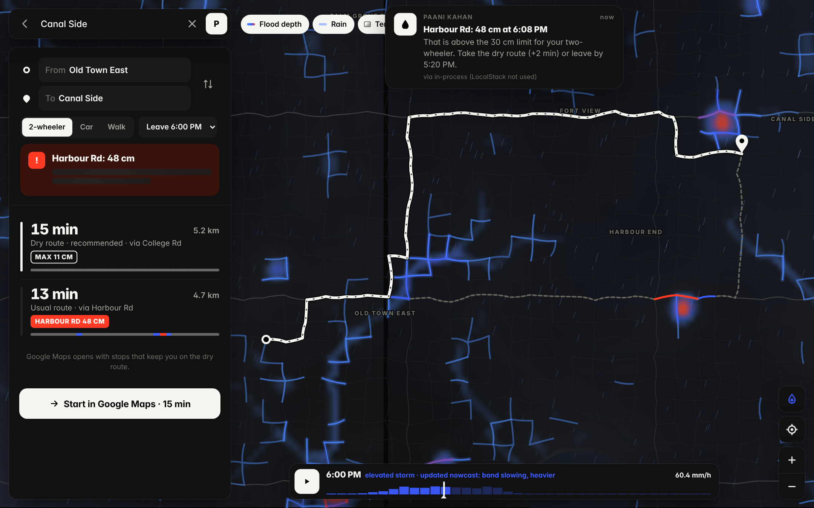
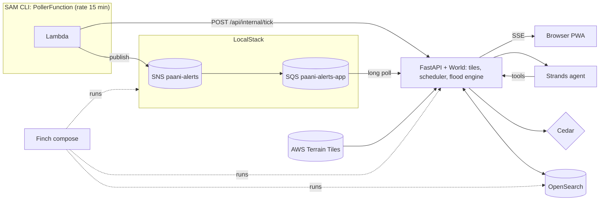

# Paani Kahan

**Which streets will flood in the next 6 hours, and how deep.** A street-level monsoon flood forecast for everywhere within reach of you. It checks your commute before you leave and hands you to Google Maps on a route that stays dry.

Built for Environmental Hacks 2026 (Track 02: Heat and Water) with AWS open-source tools: **OpenSearch, Strands Agents SDK, Cedar, AWS SAM CLI, LocalStack and Finch**, plus **Terrain Tiles from the AWS Registry of Open Data**.



---

## Run it

You need **Finch** (or Docker) and about 4 GB of free RAM.

```bash
make up                 # or: finch compose up --build -d   (docker compose works too)
open http://localhost:8080
```

The map opens straight away. Streets load around you in the background:

- **every street within 10 km**, nearest first;
- **main roads and terrain for 100 km**;
- **whatever you scroll to.**

There is no setup step and no "build my area" screen. The first visit to a new place takes a little while to fill in (OpenStreetMap is fetched politely, one query at a time). After that it's cached on disk under `data/world/` and opens instantly.

**Recommended before recording the demo:**

```bash
make model              # ollama pull llama3.2:3b, the local model for the Strands agent
make warm               # optional: pre-load Velachery (or LAT=13.08 LON=80.27) so nothing is loading on camera
make tick               # the nowcast update: SAM Lambda -> SNS -> SQS on LocalStack -> your browser
```

<details>
<summary>Updating from an earlier version</summary>

```bash
finch compose down
finch compose up --build -d
```
The old `data/velachery` folder isn't used any more; you can delete it.
</details>

<details>
<summary>No make? Plain commands</summary>

```bash
finch compose up --build -d                       # or docker compose
ollama pull llama3.2:3b
python3 scripts/warm.py 12.979 80.223             # optional pre-load
cd serverless && sam local invoke PollerFunction  # uses samconfig.toml: docker network paani-net
# without SAM:  APP_URL=http://localhost:8080 AWS_ENDPOINT=http://localhost:4566 python3 serverless/poller/app.py
curl -X POST localhost:8080/api/internal/reset    # demo storm: back to 4:10 PM
```
</details>

### Using it

It works like a maps app, on a phone or a laptop.

| | |
|---|---|
| **Search** (top) | streets, localities, hospitals and schools near you (OpenSearch, ranked by distance), plus places anywhere in India |
| Tap a street | its depth now, a 6-hour depth curve, past flood reports |
| **Directions** | From / To, travel mode, leave time; routes coloured by depth along their length; **Start in Google Maps**. Works for trips up to ~180 km: street level near both ends, main roads in between |
| Bottom sheet (phone) | drag between peek, half and full; on a laptop it's the left panel |
| Timeline | scrub the next 6 hours, or press play (Space) |
| Layer chips | flood depth, rain, terrain, closures, hospitals and schools (emergency control only, by Cedar policy) |
| Account menu | switch Priya / Ravi / Control room, theme, alerts, install, **Open on your phone**, How it works |
| Keyboard | `/` search · Space play · D how it works · Esc back · + / − zoom |

### Demo storm (works on the map you're looking at)

How it works → System → **Demo storm here**, or the button on the home sheet. It starts an **elevated storm**: a band of very heavy rain (peaks of 60–85 mm/h) centred **wherever you are**, crossing from the south-east and reaching you around 6 PM. The streets, terrain, drains and routing are all real; only the rain is scripted, and the app labels it (blue **DEMO STORM** badge). A demo commute is picked on your streets so the story always works:

- **4:10 PM:** the route is passable (Watch).
- `make tick` (the 4:25 PM nowcast update): the route is flooded, an alert arrives, and a dry route is offered.

Switch back with **Live**. You can also replay real Chennai storms (Cyclone Michaung, Dec 2015, Nov 2021, Dec 2021) on today's streets.

### Installable, offline, background alerts

It's a Progressive Web App. Tiles and forecasts you've seen are cached, so it opens instantly and works offline ("Offline · saved 4:25 PM"). **Flood alerts on this device** turns on notifications. Installed on Chromium browsers, it re-checks your commute in the background about every 15 minutes.

## Open it on your phone

Browsers only allow **location, offline use, installing and notifications on HTTPS pages**, so there are two options.

**1. Phone link (recommended, everything works).** A free Cloudflare quick tunnel gives the app an `https://….trycloudflare.com` address. No account needed, and it works even when the phone isn't on your Wi-Fi.

```
finch compose --profile phone up -d
```

Then on the laptop open http://localhost:8080 → account menu (the **P** square) → **Open on your phone**, and scan the QR code. The address changes each time the tunnel restarts. Anyone with the link can open the app, so stop it when you're done: `finch compose stop tunnel`.

**2. Same Wi-Fi only (no location, offline or install).** In PowerShell **as Administrator**, from the project folder:

```
powershell -ExecutionPolicy Bypass -File scripts\phone-lan.ps1
```

It prints an address like `http://192.168.1.20:8081` to open on the phone. To show a QR code for it in the app, put `PHONE_LAN_URL=…` in `.env` and run `finch compose up -d app`. If the phone can't connect, set the Wi-Fi network to **Private** in Windows settings. Undo with `scripts\phone-lan.ps1 -Remove`.

## How it loads data

The short version is below. [ARCHITECTURE.md](ARCHITECTURE.md) has the full design.

- **Tiles.** The map is cut into Web-Mercator tiles: street-level (~5 km, 20 m flood grid) and main-road (~38 km, 150 m grid). Each tile is fetched, built and forecast independently.
- **Priority queue.** What's on your screen goes first, then your route, then streets near you, then main roads out to 100 km, then everything else. Moving the map re-prioritises it.
- **Caching.** Streets and terrain are cached on disk (30 days and forever). Rain comes from a fixed 0.125° lattice shared by all tiles, so tiles agree at their seams.
- **Never blocking.** The newest finished forecast is shown while the next one computes. The browser is told by server-sent events when each tile is ready.
- **Resilient upstreams.** Per-service rate limits, retries and circuit breakers. A slow or failing service degrades one layer, not the app. Its state shows in How it works → System.

## Live data

| Data | Source | Refresh |
|---|---|---|
| Rain | Open-Meteo 15-minute forecast on a 0.125° lattice | every 15 min near you, hourly further out |
| Streets, water bodies, localities, hospitals, schools | OpenStreetMap (Overpass) | per tile, cached 30 days |
| Elevation | Terrain Tiles, AWS Registry of Open Data | per tile, cached forever |
| Drain sizing | 35 years of hourly ERA5 rain, Gumbel fit (2-year storm) | once per area, cached |
| Wet ground, tide | Open-Meteo forecast and marine | hourly |
| Closures | TomTom (optional key), OpenStreetMap construction and barriers, residents' "road closed" | with each refresh |
| Flood reports | **residents using the app** | instantly; each report corrects the forecast within 120 m for 90 minutes |
| Places in India | Nominatim | per search |

## What it does

1. **Forecasts depth per street, every 10 minutes, 6 hours ahead**, for every street around you.
2. **Checks your saved commute** at the time you'd actually reach each street, against a safe limit for how you travel: 30 cm on a two-wheeler, 45 cm by car, 25 cm on foot.
3. **Finds a dry route** and opens it in **Google Maps** with waypoints that pin it there.
4. **Stays silent until it matters.** One notification when a new nowcast puts your route under water.
5. **Gives ward officers and emergency control their own view**: localities to send pumps to first, hospitals and schools about to be cut off.

## Tuned to Chennai

| What | Data | Effect |
|---|---|---|
| **Drain capacity** | 35 years of hourly ERA5 at your location, Gumbel fit | drains carry a ~2-year storm (CPHEEO practice); the app says how rare the forecast's heaviest hour is |
| **Wet ground** | last 3 and 7 days of rain, soil moisture | runoff from 78% (dry) to 95% (saturated); drains lose up to 25% after a very wet few days |
| **High tide** | sea level off the coast | low-lying drains slow by up to 40% around high tide |
| **Subways** | OSM underpasses | cut into the terrain with pumps; "likely closed" above 30 cm and avoided, as the city closes them |
| **Bridges and flyovers** | OSM | stay dry |
| **Past floods** | documented closures (Dec 2021, Cyclone Michaung 2023) with source links | shown as "documented" history; localities with history get weaker drains |
| **Storm replays** | recorded ERA5 rain for four past storms | replay them on today's streets |

**Accuracy, honestly:** this is calibrated to Chennai's rainfall climate and checked against past storms, not validated street by street. That needs measured flood depths and the city's drain network, which aren't public.

## Where each AWS tool fits



| Tool | What it does here | Where |
|---|---|---|
| **OpenSearch** | Place search across every loaded tile (`search_as_you_type` + `gauss` distance decay); the forecast as **one document per wet street** with depth per 10-minute frame (`d0…d36`), so "flooding near you at 6 PM" is a `geo_distance` filter + range on one field; locality aggregations for pump priority; `msearch` for hospitals losing access; full-text + geo flood history. Re-indexed tile by tile as forecasts land. Every query's DSL is shown in How it works → System. | `app/store.py` |
| **Strands Agents SDK** | The advisory agent: three tools (`check_route`, `flood_history`, `best_departure`), works across tiles. Ollama by default; Claude with `MODEL_PROVIDER=anthropic`. | `app/agent.py` |
| **Cedar** | Authorizes every request: routes public; your commute only yours; officers see their own locality (localities come from the tiles around you); vulnerable sites for emergency control only. | `app/policies/paani.cedar` |
| **AWS SAM CLI** | The nowcast poller Lambda on a 15-minute schedule, plus its SNS topic. `sam local invoke` runs it against LocalStack. | `serverless/` |
| **LocalStack** | SNS → SQS, the same event path as on AWS. The app long-polls SQS and streams alerts to the browser. | `compose.yaml`, `app/alerts.py` |
| **Finch** | `finch compose up` runs the stack. | `compose.yaml`, `Makefile` |
| **AWS Registry of Open Data** | Terrain Tiles (terrarium PNGs) for elevation, cached per PNG. | `app/world/providers.py` |

## Project layout

```
app/
  server.py          thin HTTP layer: tiles, routes, search, reports, SSE
  world/
    world.py         tiles, pipeline (fetch → build → forecast → index), routing composites, demo setup
    scheduler.py     keyed priority jobs on net + cpu pools
    tiles.py         tile math, the two levels of detail
    providers.py     OpenStreetMap, AWS Terrain Tiles, synthetic world
    rainfield.py     seamless rain: live lattice, elevated demo storm, replays
    context.py       climate (drain sizing), wet ground, tide
    net.py           upstream rate limits, retries, circuit breakers, disk cache
  engine/
    hydro.py         the flood model (vectorised)
    routing.py       flood-aware routing + Google Maps handoff
    area.py          streets + terrain -> segments (with tile ownership)
    chennai.py       Chennai climate, history, replays
    traffic.py       TomTom incidents
    story.py         picks the demo commute
  store.py           OpenSearch (and in-memory fallback)
  agent.py           Strands agent
  policy.py, policies/paani.cedar
  alerts.py          SQS listener + browser event bus
  web/               the interface (no build step)
serverless/          SAM template + poller Lambda
scripts/             warm.py (pre-load), phone-lan.ps1
tests/               fake upstreams for offline end-to-end runs
ARCHITECTURE.md      the design
DEMO.md              shot-by-shot demo plan
WRITEUP.md           submission writeup
```

## Configuration

Copy `.env.example` to `.env`. Everything is optional.

| Variable | Default | |
|---|---|---|
| `RAIN_SOURCE` | `live` | `live`, `demo` (elevated storm) or `replay:michaung2023`; also switchable in the app |
| `DEFAULT_ORIGIN` | `12.979,80.223` | where the map opens before your location is known (Velachery) |
| `DETAIL_KM` / `REGION_KM` | `10` / `100` | street-level / main-road coverage around you |
| `CPU_WORKERS` | `3` | flood-model threads |
| `DATA_SOURCE` | `osm` | `synthetic` = invented streets that work fully offline (labelled) |
| `MODEL_PROVIDER` / `OLLAMA_MODEL` / `ANTHROPIC_API_KEY` | `ollama` / `llama3.2:3b` | the agent's model |
| `TOMTOM_API_KEY` | | live closures and flooding from TomTom |
| `LIVE_REFRESH_MIN` | `15` | live rain refresh |
| `DEMO_NOW` | `16:10` | the clock in demo-storm mode |

## Troubleshooting

- **A new place takes a while to fill in:** that's OpenStreetMap being fetched, one query at a time, nearest first. How it works → System shows the tile grid and each upstream's state. Once fetched, it's instant.
- **Rain says "waiting for Open-Meteo" or tiles show "stale":** an upstream is slow or down; the app keeps the last forecast and retries by itself.
- **Phone: "Open on your phone" shows no link** after starting the tunnel: wait 10 seconds and try again; check `finch compose logs tunnel` for a `trycloudflare.com` line.
- **Phone: the location button says it needs HTTPS:** you opened the Wi-Fi address; use the phone link.
- **OpenSearch exits on Linux:** `sudo sysctl -w vm.max_map_count=262144`. The app runs on its in-memory store until OpenSearch is up, then switches over.
- **Agent shows "Template":** start Ollama (`ollama serve`) and `make model`.
- **`sam local invoke` can't reach the app:** it runs on the `paani-net` network, so the app must be running via compose.
- **LocalStack asks for an auth token:** the compose file pins `localstack/localstack:3.8.1`, which doesn't need one. Without LocalStack, use How it works → System → *Run nowcast update* (in-process; the UI says so).

## Limitations

- **Elevation** is SRTM-derived (30 m; measures rooftops and trees in dense areas). Production would use CartoDEM or LiDAR plus storm-drain maps.
- **Main-road tiles** use a 150 m grid: fine for long trips and the zoomed-out view, coarse for individual streets. Street-level tiles replace them near you.
- **Water bodies** from OSM multipolygons are stitched from their outer rings; inner islands are ignored.
- **The demo storm is scripted** (labelled) so the video is reproducible on a dry day. IMD radar nowcasts would be the production rain source.
- **Routing** treats streets as two-way. Google Maps does the actual navigation.
- Depths are forecasts, not guarantees.

## Data and licences

Streets, water bodies, localities and facilities: © OpenStreetMap contributors (ODbL). Elevation: Terrain Tiles, AWS Registry of Open Data (SRTM, public domain). Rain: Open-Meteo (CC BY 4.0), ERA5 (Copernicus). Font: Inter Tight (SIL OFL) via Google Fonts.
